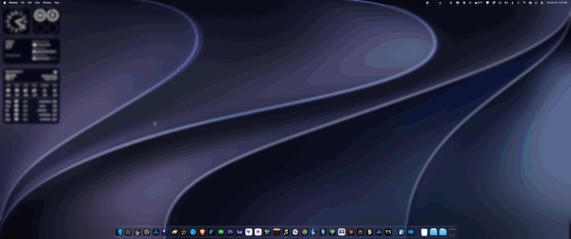
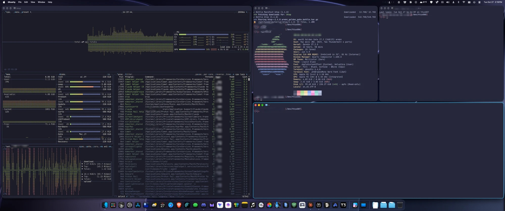
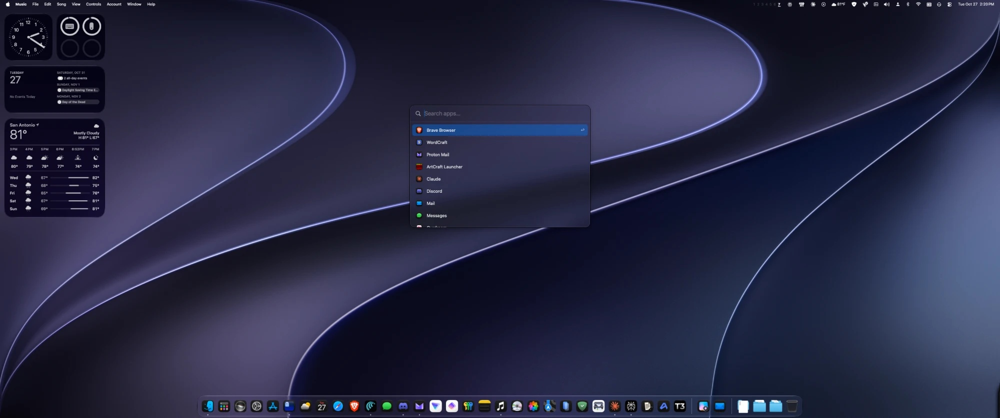
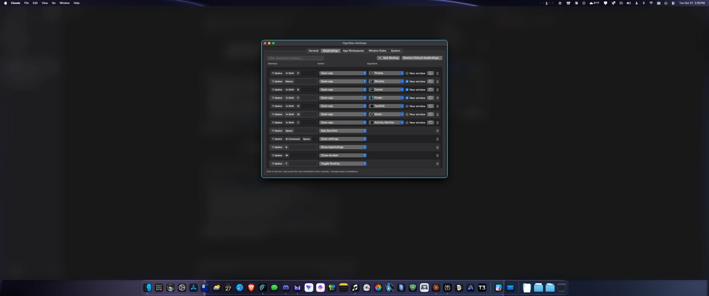

# HyprMac

A small native tiling window manager for macOS that brings Hyprland's tiling behaviour to the Mac.



What it does:

- **Dwindle layout.** Each new window splits the focused tile along its longer side, so windows form a spiral, the same as Hyprland's default layout.
- **Workspaces 1–10.** HyprMac runs its own workspaces, like Hyprland, instead of using macOS Spaces. Each display shows one workspace, and switching is instant with no Mission Control animation.
- **Hyprland-style keybindings**, plus mouse controls: hold ⌥ Option and drag, right-drag or scroll.
- **Gaps and an active border.** The defaults match a typical Hyprland config: `gaps_in 5`, `gaps_out 10`, and a 2 px border.
- **A built-in app launcher** (⌥ Option + Space): type, use the arrow keys, and press Return.
- **Menu-bar workspace indicator**, similar to Waybar's, showing each workspace's number with the icons of the apps on it.
- **Hyprland-style window management.** Scratchpad, pop-out (float and pin), minimize, close all, monitor moves, fine and coarse resize steps, the gaps toggle, single-window square, and Picture-in-Picture windows that float and pin to the top right.
- **Hover or click to focus.** Choose in Settings › General whether a window takes focus as soon as the pointer moves onto it (the default, like Hyprland's `follow_mouse = 1`) or when you click it (the macOS default). With hover, floating windows (HyprMac's Settings included) take focus too and stay above the tiles as focus moves on. Dialogs keep focus until they close.
- **The pointer follows focus.** When you move focus with ⌥ Option + arrow keys or open a new window, the pointer jumps to it. You can turn this off in Settings › General.
- **Windows stack in three layers.** Dialogs, alerts and sheets (anything waiting on an answer, including HyprMac's own) are always on top. Below them are floating windows: fixed-size app windows, apps on the Always float list, windows you float yourself, and HyprMac's Settings. Tiles are at the bottom. Whenever focus changes, HyprMac puts that order back, so a tile never covers a floating window and a floating window never covers a dialog. Dialogs also get the pointer and keep focus until closed. So do floating windows from apps you add under Settings › Window Rules › Stay focused (like Hyprland's `stayfocused`). New floating windows open centered and get the focus glow.
- **App workspaces.** In Settings › App Workspaces, pick apps from a dropdown and choose the workspace each one opens on: a fixed one, or the one you last used it on. Tick **Open at startup** to have HyprMac open the app when it starts.
- **Room for screenshots.** Click a screenshot thumbnail to edit it and HyprMac switches to an empty workspace, then back when you click Done. You can turn this off in Settings › General.
- **Updates itself** from GitHub releases (see [Updates](#updates)).
- **A settings window** for every option. You can record shortcuts by pressing them, change the action for any key, set float/ignore rules for apps, and turn on launch at login.

It doesn't need SIP turned off and has no dependencies. It's built from Swift source with the Command Line Tools.

## Screenshots



| App launcher (⌥ Option + Space) | Settings, above the tiles |
|---|---|
|  |  |

## Install

1. Download the latest `HyprMac-<version>.dmg` from [Releases](https://github.com/TheDoodAbides87/HyprMac/releases).
2. Open it and drag **HyprMac** into **Applications**.
3. Open HyprMac. It isn't notarized by Apple, so the first time macOS blocks it: go to **System Settings › Privacy & Security**, scroll down and click **Open Anyway**.
4. When asked, allow HyprMac under **Privacy & Security › Accessibility**. Tiling starts as soon as you do.

Requires macOS 14 or later.

## Updates

HyprMac checks this repository's releases a little after it starts and every 6 hours after that. When a newer version is out, it downloads it, checks it, restarts and puts every window back on its workspace. Change this in **Settings › System › Updates**:

- **Update channel.** **Stable** (the default) only installs full releases. **Beta** also installs pre-releases. They get new features first but are less tested, so things might break; HyprMac asks you to confirm before switching. Going back to Stable keeps the beta you have until a newer stable release comes out.
- **Check for updates automatically** and **Install updates automatically.** With automatic installing off, HyprMac asks before installing. You can also choose **Check for Updates…** from the menu bar.

An update is only installed if it's signed with the same certificate as the copy you're running. This also means macOS keeps HyprMac's Accessibility permission after updating. Versions before 1.0 can't update themselves, so install 1.0 by hand once.

## Build from source

```bash
./build.sh --install
```

This builds `build/HyprMac.app`, copies it to `~/Applications`, and launches it. The first time it runs, macOS asks you to grant **Accessibility** access. HyprMac starts tiling as soon as you allow it.

To package the disk image for sharing, add `--dmg`. That writes `build/HyprMac-<version>.dmg`, with the drag-to-Applications window. Arranging that window asks Finder, which macOS may ask you to allow once.

> The first build creates a self-signed certificate in its own keychain file at `~/.config/hyprmac/signing/`. It isn't added to your login keychain or marked as trusted. Signing every build with it means macOS recognises rebuilds as the same app, so the Accessibility permission stays valid.

## Default keybindings

Window shortcuts use **⌥ Option** as the main modifier. A few also add **⌘ Command** as a second modifier. You can change both under Settings › General. For example, pick ⌘ Command as the main modifier if you'd rather keep ⌥ + arrow for jumping between words.

| Shortcut | Action |
|---|---|
| ⌥ Option + Return | Terminal (Ghostty / Alacritty / kitty / WezTerm / iTerm / Terminal, whichever is installed), new window |
| ⌥ Option + Space | App launcher (change the action to “Spotlight search” to use Spotlight / Raycast / Alfred) |
| ⌥ Option + ⌘ Command + Space | HyprMac settings |
| ⌥ Option + K | Keybinding cheat sheet |
| ⌥ Option + ⇧ Shift + B / F / N / M / T | Browser / Finder / editor / music / Activity Monitor |
| ⌥ Option + ⇧ Shift + Return | Browser |
| ⌥ Option + ⇧ Shift + Q / / | Calculator / Passwords |
| ⌥ Option + W or Q | Close window |
| ⌃ Control + ⌘ Command + ⌦ Delete | Close all windows, then go to workspace 1 |
| ⌥ Option + ⇧ Shift + W | Quit the app in front (like ⌘Q) |
| ⌥ Option + M | Minimize window |
| ⌥ Option + T | Toggle floating |
| ⌥ Option + O | Pop window out: float it at 1300×900, centered, and pin it so it stays on screen across workspaces. Again to put it back |
| ⌥ Option + F | Fullscreen |
| ⌥ Option + ⌘ Command + F | Maximize, keeping gaps |
| ⌥ Option + J | Toggle split direction |
| ⌥ Option + P | Pseudo-tile (window keeps its own size, centred in its tile) |
| ⌥ Option + ←↑→↓ | Move focus (crosses monitors) |
| ⌥ Option + ⇧ Shift + ←↑→↓ | Swap window (moves to the next monitor at an edge) |
| ⌥ Option + − / = | Shrink / grow width |
| ⌥ Option + ⇧ Shift + − / = | Shrink / grow height |
| add ⌘ Command / ⌃ Control to the resize keys | Resize by a little (25 px) / a lot (300 px) |
| ⌥ Option + ⇧ Shift + ⌫ | Toggle gaps and border |
| ⌥ Option + ⌃ Control + ⌫ | Keep a workspace's only window square |
| ⌥ Option + 1…0 | Switch to workspace 1–10 |
| ⌥ Option + ⇧ Shift + 1…0 | Move window to workspace 1–10 |
| ⌥ Option + ⇧ Shift + ⌘ Command + 1…0 | Move window to workspace 1–10 without following it |
| ⌥ Option + S | Show / hide the scratchpad (a hidden workspace shown over the current one) |
| ⌥ Option + ⌘ Command + S | Move window to the scratchpad |
| ⌃ Control + ⌘ Command + Tab / ⇧ Shift + Tab | Focus next / previous monitor |
| ⌥ Option + ⇧ Shift + ⌃ Control + ←↑→↓ | Move window to the monitor in that direction |
| ⌥ Option + ⇧ Shift + ⌘ Command + ←↑→↓ | Move workspace to the monitor in that direction |
| ⌥ Option + Tab / ⇧ Shift + Tab | Next / previous occupied workspace |
| ⌃ Control + ⌥ Option + Tab | Former workspace |
| ⌃ Control + ⌥ Option + Esc | Pause / resume tiling |
| ⌥ Option + drag | Move window. Drop a tiled window on another to swap them |
| ⌥ Option + right-drag | Resize window |
| ⌥ Option + scroll | Cycle workspaces |

You can also drag a tiled window by its title bar and drop it on another window to swap them. Dragging a tile edge resizes the split.

## Configuration

Everything is stored in `~/.config/hyprmac/config.json`. The settings window writes to this file and applies each change straight away. You can also edit the JSON by hand and choose **Reload Config** from the menu bar.

App shortcuts are picked from a dropdown of installed apps in Settings › Keybindings. Tick **New window** to get a fresh window (⌘N) when the app is already open. For anything else, click the terminal button beside the dropdown and enter a shell command. Commands run through `zsh -c`, with Homebrew on the `PATH`. In the JSON, an app shortcut looks like this:

```json
{ "mods": ["super"], "key": "return", "action": "openapp", "arg": "com.mitchellh.ghostty", "newWindow": true }
```

And a command shortcut looks like this:

```json
{ "mods": ["super", "shift"], "key": "g", "action": "exec", "arg": "open -na Ghostty --args -e lazygit" }
```

In the JSON, `super` means the main modifier and `alt` means the second modifier, whichever keys you chose for them. The other names are `ctrl` and `shift`, plus `cmd` and `opt` for a physical key that isn't the main or second modifier.

## macOS caveats

- **Workspaces are emulated.** Windows on hidden workspaces are moved to the bottom-right corner of the screen, and about 1 px of them may show. When you quit or pause HyprMac, every window is brought back on screen.
- **Multiple monitors:** turn off System Settings › Desktop & Dock › *Displays have separate Spaces*, then log out once. Also turn off *Automatically rearrange Spaces*.
- Native macOS full screen (the green button) creates its own Space. Use ⌥ Option + F instead.
- HyprMac has no animations and no blur. macOS doesn't let a third-party window manager draw those effects on other apps' windows.

## Source layout

| File | What it does |
|---|---|
| `Dwindle.swift` | Layout tree: insert, remove, swap, resize ratios |
| `WindowManager.swift` | Window discovery (AX observers), workspaces, monitors, focus, actions, mouse drag |
| `InputTap.swift` | CGEventTap that handles hotkeys and mouse bindings; active-border overlay |
| `Config.swift` | Config model, default bindings, JSON store, key names |
| `SettingsView.swift` | SwiftUI settings window and keybinding cheat sheet |
| `Launcher.swift` | Built-in app launcher |
| `Apps.swift` | Installed-app catalog and default apps |
| `Updater.swift` | Self-updates from GitHub releases |
| `AppDelegate.swift` | Menu-bar item, permission flow, window plumbing |

## License

MIT. See [LICENSE](LICENSE).
